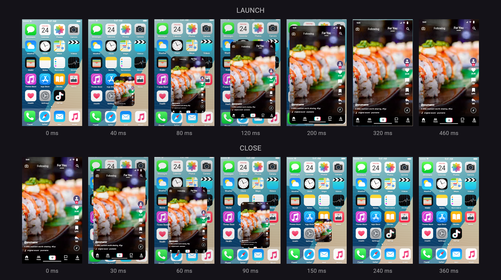

# Experimental Maps lookup test

[Download Mockareel Maps POC 1](https://github.com/jc-tanedo/mockareel/raw/refs/heads/apk-preview/mockareel-maps-webview-poc-1.apk) — separate app, no API key for place search. [Instructions, screenshots and limitations](maps-webview-poc-1.md).

---

# Mockareel Android preview

[Download v0.12.1 APK](https://github.com/jc-tanedo/mockareel/raw/refs/heads/apk-preview/mockareel-0.12.1.apk)

Install over your current preview; signing certificate and application ID are unchanged.

## v0.12.1 — snappier app motion

- Preview playback now follows display vsync instead of a 40 ms timer that limited UI motion to 25 updates per second. Pause, resume, restart and lifecycle handling remain supported.
- App launch uses a 460 ms critically damped spring; close uses a separate 360 ms spring. Most travel happens early, with a short settling tail and a brief fade near the icon.
- The app window preserves its contents' proportions, clips to rounded corners and returns to the selected launch tile. Home-screen artwork scales and dims subtly behind the window. The video player remains mounted across home/feed boundaries.
- Shared motion and duration constants drive preview, the timeline and captured export UI. Export remains 1080×1920 at 30 fps. Repeated home holds still reuse their UI images.

The image is a Flutter render of sampled animation positions, not a device frame-rate measurement or a native encoded-video capture.

## Export workspace

| Phone | Landscape |
| --- | --- |
|  |  |

The export workspace from v0.12.0 retains job stages, elapsed time, percentage, cancellation and a progress-driven scene preview. Video media appears as stills in the monitor. Duplicate search-text states and home holds share prepared PNGs without removing timeline samples.

Source: `ef63dc5b085284d5f1f17019aca0fa7676dfbd2c` on `main` and `work`.

Validation: 62 Flutter tests, five Kotlin tests and five release-metadata tests; formatting/analysis clean; visual review of launch/close samples. New tests cover monotonic spring motion, exact icon/screen endpoints across presets, quick opacity settling and preview progress on successive simulated 120 Hz ticks with pause/resume/restart. Existing tests verify player continuity and actual export-frame masks. APK signature, package/version, ZIP integrity, 16 KB alignment and credential-pattern checks passed. Physical-device smoothness and native encoding were not measured for this update.

SHA-256: `b56eb684486923d5dd07da48457ec0f8ff9ecf338bc73511554bf4b574f68a7a`

Earlier versioned APKs and preview images remain available on this branch.
