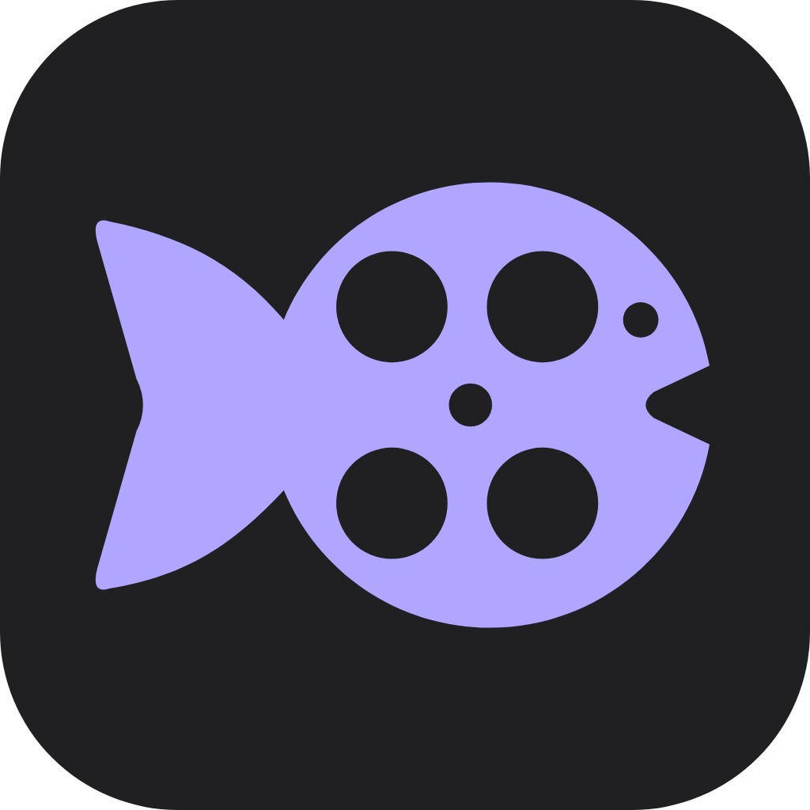

<p align="center">
  
</p>
<h1 align="center">Mockareel</h1>
<p align="center">Create mock app reels from your photos and videos.</p>
<p align="center">
  <a href="https://github.com/jc-tanedo/mockareel/actions/workflows/android-debug.yml"></a>
  <a href="LICENSE"></a>
  
</p>
<p align="center">
  <a href="https://github.com/jc-tanedo/mockareel/releases">Releases</a> ·
  <a href="docs/user-guide.md">User guide</a> ·
  <a href="#development">Development</a> ·
  <a href="docs/android-ci.md">Build & release</a> ·
  <a href="SECURITY.md">Security</a>
</p>

Mockareel is a Flutter editor for 9:16 videos that recreate familiar app interfaces. Choose a template, add your media, customize the UI, and export a reel. Projects save locally and can be shared as portable backups.

> **Maps WebView POC branch:** key-free search through a hidden, attached WebView. The Android app installs separately as **Mockareel Maps POC**. [Test instructions and limitations](docs/maps-webview-poc.md).

## Templates

| Template | What you can make |
| --- | --- |
| **Maps place story** | A map or photo header, editable place details and buttons, horizontal media cards, movable text, optional featured review, and light/dark output. |
| **TikTok FYP scroll** | Typed search or a home-screen opening, editable posts and engagement counts, timed vertical swipes, and an optional app-close ending. |

Both templates support photos, trimmed video, framing controls and optional background music. The FYP home screen includes iPhone, Android, Pixel and Samsung One UI presets, plus controls for using a supplied screenshot without duplicate overlays. Each preset uses its own layout and editable app artwork based on home-screen references.

## Get started

1. Install an APK from [Releases](https://github.com/jc-tanedo/mockareel/releases) or the **Artifacts** section of an [Android debug build](https://github.com/jc-tanedo/mockareel/actions/workflows/android-debug.yml). Earlier previews remain on [`apk-preview`](https://github.com/jc-tanedo/mockareel/tree/apk-preview).
2. Select **New project**, choose a template, and add your photos or videos.
3. Follow the numbered editor steps, preview the sequence, and select **Render MP4**.

[Full user guide →](docs/user-guide.md)

- **Output:** 1080 × 1920 MP4 at 30 fps; Maps also exports transparent/full PNG stills.
- **Audio:** choose background music from your device. Source video audio is muted.
- **Projects:** autosave on device; `.mockareel` backups include media and editable settings.
- **Maps:** Google lookup requires your own API key. Manual editing and uploaded map images work without one. [Configure Maps →](docs/google-maps.md)

## Development

Requires **Flutter 3.47.7**, **JDK 21** and **Android SDK 36**. Install the Android NDK/CMake versions listed in the [development guide](docs/development.md).

```sh
git clone --single-branch --branch main https://github.com/jc-tanedo/mockareel.git
cd mockareel
flutter pub get --enforce-lockfile
bash tool/ci/check_android.sh
bash tool/ci/build_apk.sh debug
```

The app uses Dart for editing, models and storage, with Android Media3 for video export. Android is the current export target; other platforms are not yet configured.

[Architecture & testing](docs/development.md) · [CI & release signing](docs/android-ci.md) · [Brand assets](assets/brand/)

## Status

Mockareel is an early preview. Automated checks cover models, editor interactions, project backups and rendered UI surfaces. Native encoding and live Google map fetching still need physical-device verification. Neighboring videos hold still frames during transitions; app launch/close animations also use a still of the first/last post.

## Contributing

See [CONTRIBUTING.md](CONTRIBUTING.md) for setup and contribution guidelines. Report security issues privately using [SECURITY.md](SECURITY.md).

## License

[GNU General Public License v3.0](LICENSE). Mockareel is an independent project; the interface templates are not affiliated with Google, TikTok, Apple or Samsung.
