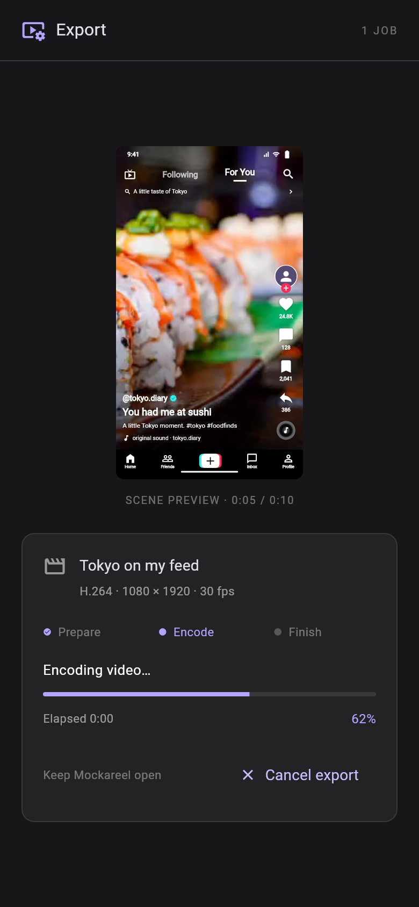
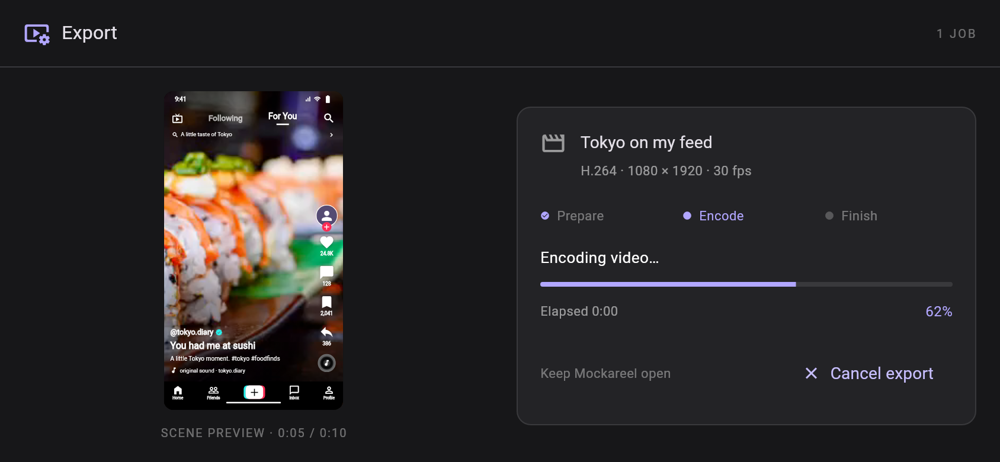
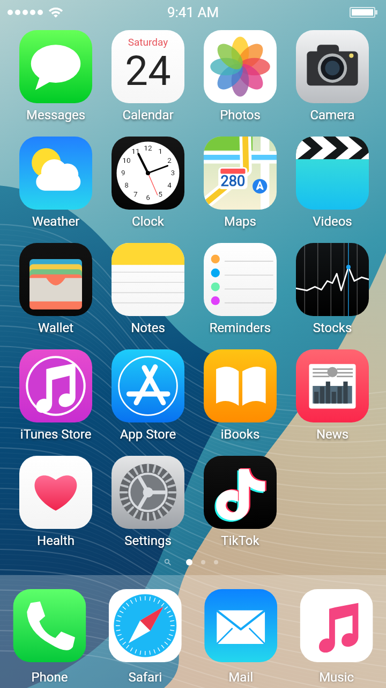
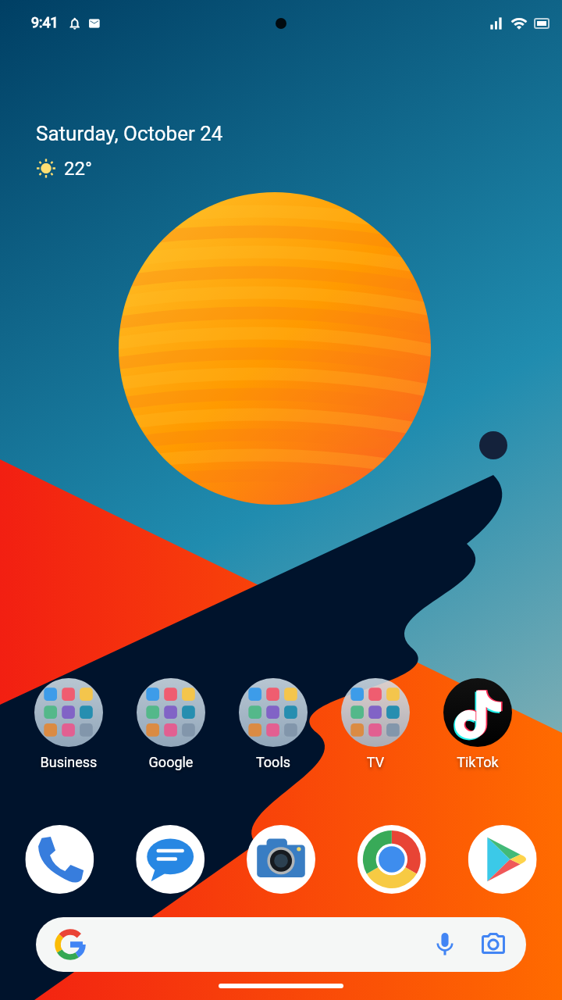
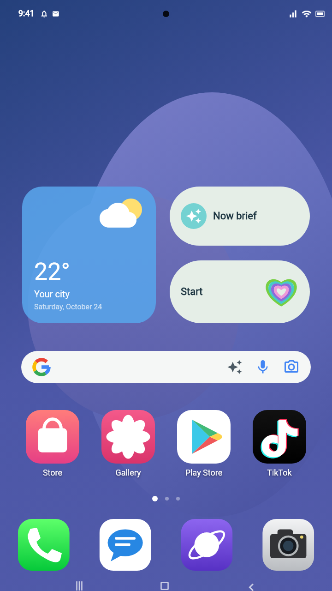

# Mockareel Android preview

[Download v0.12.0 APK](https://github.com/jc-tanedo/mockareel/raw/refs/heads/apk-preview/mockareel-0.12.0.apk)

Install over your current preview; signing certificate and application ID are unchanged.

## v0.12.0 — export workspace

| Phone | Landscape |
| --- | --- |
|  |  |

- A charcoal/violet encoder-style export workspace for both templates: themed typography, scene preview, job details, Prepare/Encode/Finish stages, percentage, elapsed time and cancellation.
- The scene preview follows preparation and reported encoding progress. Videos appear as stills; this is not a live view of the encoded frames. Preview players are released during export to avoid competing with the encoder.
- Feed export reuses identical search-text states and home-screen holds. Every 30 fps sample remains in the scene plan; output stays 1080×1920. In the tested two-second hold examples, opening overlay captures drop from 78 to 18 unique PNGs and closing captures from 80 to 21. Loading dots and swipe animation remain fully sampled. Device speedup has not been benchmarked.
- Home launch and app close keep the same feed video player mounted, extending the earlier media-to-media flicker fix. The opening video preloads paused, and the closing video pauses inside its last frame rather than replacing its texture.
- Remove post and Undo from v0.11.1 remain available beside the post selector.

Source: `6f5842894527fd0242bb12b7965db530d556c31f` on `main` and `work`.

Validation: 60 Flutter tests, five Kotlin tests and five release-metadata tests; formatting/analysis clean; phone/landscape visual review. Tests cover player identity and play/pause through home transitions, repeated UI samples with Unicode text, actual export-frame alpha and shared paths, PNG exports, responsive monitor styling and cancellation control. APK signature, package/version, ZIP integrity, 16 KB alignment and credential-pattern checks passed. Physical-device playback, native encoding and device timing were not run for this update.

SHA-256: `345ad50a67259e780fc77c550b2de5ed8921614c79da20ae373dbc60f3179f7d`

## Reference home screens

| Classic iPhone | Google Pixel | Samsung One UI |
| --- | --- | --- |
|  |  |  |

The images are Flutter renders with original vector icons and wallpapers. Earlier versioned APKs and preview images remain available on this branch.
