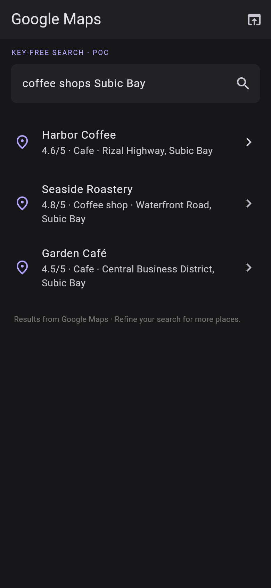
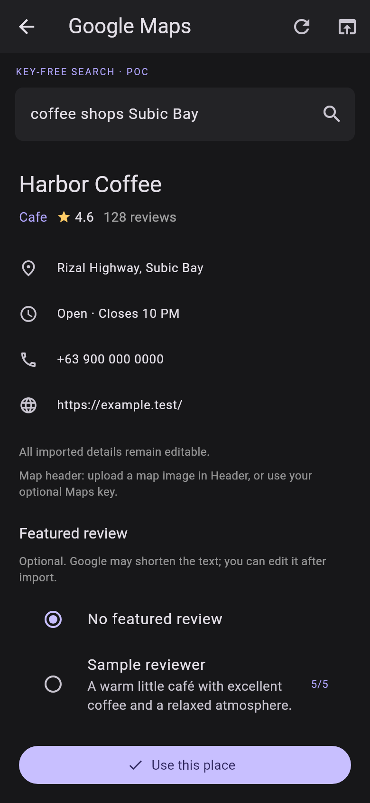

# Hidden WebView Maps lookup — POC 1

[Download test APK](https://github.com/jc-tanedo/mockareel/raw/refs/heads/apk-preview/mockareel-maps-webview-poc-1.apk) · [SHA-256](mockareel-maps-webview-poc-1.apk.sha256)

This installs as **Mockareel Maps POC** with a separate application ID (`dev.mockareel.mockareel.mapspoc`). Keep the normal app installed; the POC has its own project data. Export/import `.mockareel` backups to transfer projects if desired. This is a development-signed test APK, not a production update.

Source branch: [poc/maps-webview-search](https://github.com/jc-tanedo/mockareel/tree/poc/maps-webview-search), commit `c22f5995c6973b86d0286e91167ffe7b659c1452`. `main` and `work` remain on the stable source.

## Try it

1. Create a **Maps place story** and choose **Find a place on Google Maps**.
2. Enter a query such as `coffee shops Subic Bay Freeport Zone`, or paste a Google Maps share link. No API key is needed for this search.
3. Choose a native result card. Inspect the fetched details and optionally select a featured review; choose **Use this place**.
4. Edit the imported fields in the existing editor, add your media and export.

The native UI covers an attached, active WebView. It uses desktop-site mode and English Google Maps labels. Search submits explicitly; results and listing details come from the rendered DOM. Contacts and rating/review fields are imported when available. Review excerpts may be shortened on Google Maps and remain editable. Up to 15 currently loaded cards are read; refine the query for additional places.

**Show browser** lets you complete a Google interaction manually, then **Read page** reads the current page. **Refresh place details** picks up late fields. API lookup remains available in the search menu; manual editing remains available after leaving search.

**Map header limitation:** this first POC does not capture a map header from the WebView. Upload a map image under **Place → Header**, choose a photo header, or use your optional Maps API key for the existing automatic map image.

## UI samples

| Native search results | Details and optional review |
| --- | --- |
|  |  |

These are Flutter UI renders using fictional fixture businesses, not screenshots from an Android device. The shipped app uses the live WebView backend, not fixture results.

## Validation

- The exact bundled JS asset passed live anonymous-browser search → native-result data → selected listing checks, including name, category, address, rating/review total, phone, website, opening hours, review text and author. The supplied All Hands Beach share link also passed.
- 67 Flutter tests, five Kotlin tests and five release-metadata tests passed. Additional UI visual checks, Dart analysis/formatting, workflow lint and staged secret scanning passed.
- The release APK passed signature, expected package/version/launcher/activity, ZIP integrity, 16 KB alignment and credential-pattern checks. Its bundled extractor exactly matches the browser-validated source asset.
- Physical Android WebView behavior is not yet verified. This is the purpose of this test APK. Google DOM/layout and field visibility can vary; timeouts, cancellation, manual/browser interaction and API fallbacks are included. No developer Google key or TLS-verification bypass is embedded.

Version: `0.13.0-maps-poc.1+17`.
SHA-256: `deb561ac83d5db07133442eebdd876e5dde5dd468b2d58c7a96783687197edd7`.

Previous versioned APKs and images remain available. The normal `mockareel-preview.apk` alias is unchanged.
